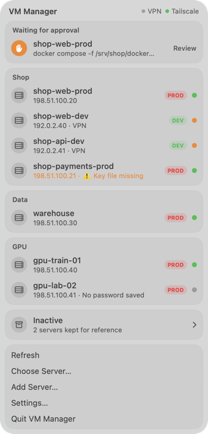
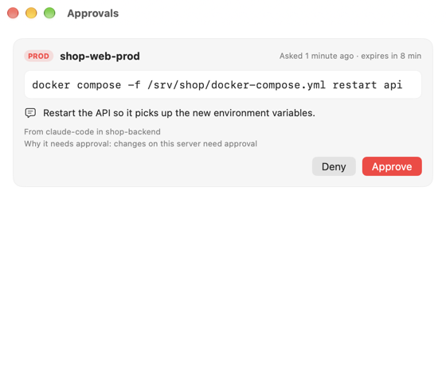
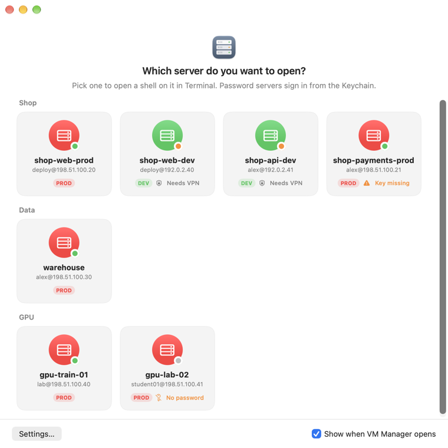
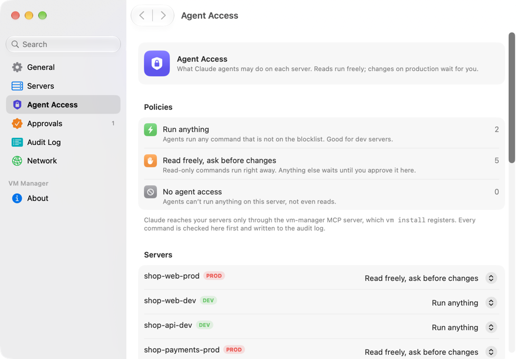
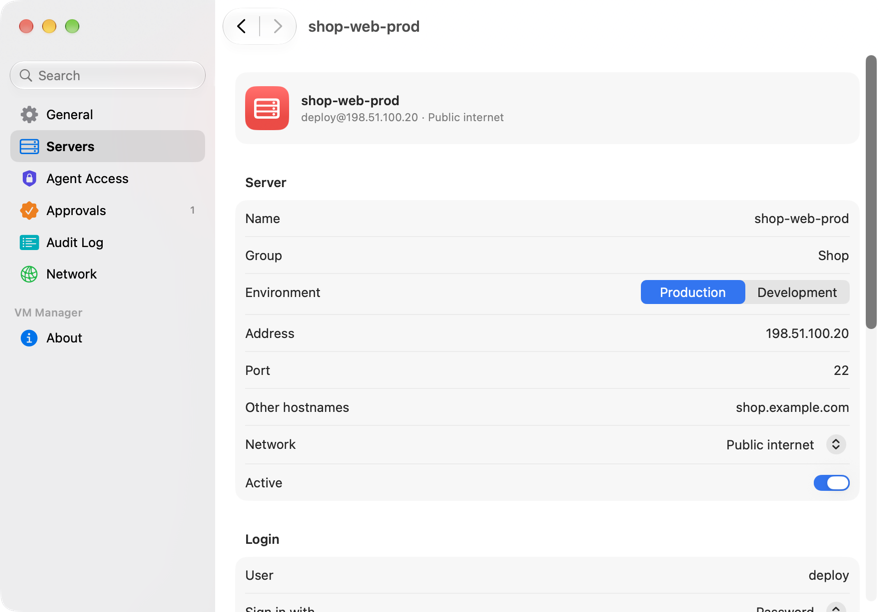

# VM Manager

Your SSH servers in one list, a native menu bar app for them, and Claude agents that can work on them under supervision.


<p align="center">
  <picture>
    <source media="(prefers-color-scheme: dark)" srcset="docs/images/menu-bar-dark.png">
    
  </picture>
</p>

VM Manager is a menu bar app and a CLI (`vm`) for the servers you reach over SSH. It keeps every host, address, user and login method in one file, writes them into `~/.ssh/config` so `ssh <name>` works everywhere, and keeps passwords in the Keychain. It also gives Claude an MCP server for those servers: read-only commands run right away, and anything that could change a production server waits until you approve the exact command.

> [!NOTE]
> The screenshots use demo data. Every address in them is from the documentation ranges 192.0.2.0/24 and 198.51.100.0/24.

## Why

A handful of servers is easy to lose track of: which IP was the payment box, which user the GPU machine wants, which ones need the VPN, and which ones still log in with a password nobody wants to type. And once an agent can SSH into them, "fix the failing container" can turn into a restart on production that nobody looked at first. VM Manager gives each server a name, makes connecting one click or one word, and puts you between the agent and every change that matters.

## Features

**Inventory**
- One list in `~/.config/vm-manager/vms.json`: name, group, prod or dev, address, port, user, key file or password, network (public, OpenVPN Connect or Tailscale), other hostnames, notes, and what agents may do.
- Inactive servers stay in the list so their addresses aren't forgotten, but never reach `~/.ssh/config` or agents.
- A warning when a server's key file is missing on this Mac.

**SSH**
- `vm sync-ssh` writes a `Host` block per server, so `ssh shop-api-dev`, `scp`, `rsync`, Zed and VS Code Remote all work by name.
- Passwords live in the Keychain. `vm ssh <name>` and the app sign in with them without showing them to you or to an agent.
- `vm key-setup <name>` copies an SSH key to a password server with the saved password, checks the key works, and switches the server to key login.

**Menu bar app**
- One module per group, a red PROD or green DEV badge on each server, and a dot for reachability: green when the SSH port answers, orange when it needs the VPN, gray when it doesn't answer.
- Click a server to open a shell in Terminal. Right-click for Copy IP, Copy SSH Command, Open in Zed, Run Status Check and Edit….
- A server picker, like Chrome's profile picker: opening the app from the Dock, Finder or Spotlight asks which server to open, and one click opens a shell on it.
- Commands waiting for approval sit at the top of the panel, and arrive as notifications with **Approve** and **Deny**.
- A Settings window in the System Settings style: servers, agent access, approvals, the audit log and network status.

**Agent access**
- An MCP server with `list_vms`, `vm_read`, `vm_change` and `vm_logs`.
- A policy per server: run anything, read freely and ask before changes, or no access.
- A hard blocklist that holds even when you approve, and an audit log of every command.

## The safety model

Claude reaches your servers through one path: the `vm-manager` MCP server. Every command takes the same steps, in this order.

1. **Policy.** Each server has one of three policies:

   | Policy | Read-only commands | Anything else |
   | --- | --- | --- |
   | `free` (run anything) | run | run |
   | `read-free-change-approve` (read freely, ask before changes) | run | waits for your approval |
   | `none` (no agent access) | refused | refused |

   A new server gets `read-free-change-approve` unless you pick another. The example list (`vm init --example`) gives its dev servers `free` and inactive servers `none`.

2. **Read-only check.** A command counts as read-only only if it has none of `; | & > < $ ( ) \` \\` or a line break, and its first word, plus its subcommand where the tool has one, is on a short list: `cat`, `head`, `tail`, `less`, `ls`, `grep`, `find` without `-exec` or `-delete`, `df`, `du`, `free`, `uptime`, `whoami`, `ps`, `top -b -n1`, `journalctl` without `--vacuum`, `systemctl status|is-active|list-units`, `docker ps|logs|inspect|images|stats --no-stream`, `docker compose ps|logs`, `git status|log|diff|show`, `ss`, `netstat`, `ip a`, `curl -I` and `nvidia-smi`. Options that write files or change state (`git log --output`, `ss -K`, `curl -o`, `hostname newname`, `less +!cmd` and so on) make it a change. A leading `sudo`, `env` or `VAR=value` makes it a change too. `vm_read` refuses anything that isn't read-only and tells the agent to use `vm_change`. Run `vm policy` for the full list, and `vm check -- <command>` to see how a command is treated.

3. **Blocklist.** These are refused every time, even on a `free` server and even if you would approve: `rm -rf /`, `rm -rf /*`, `mkfs`, `dd of=/dev/…`, `shutdown`, `reboot`, `poweroff`, `halt` and fork bombs. The check looks through `sudo`, `bash -c`, `$(…)`, backticks, quotes and `${IFS}`. `DROP DATABASE`, `DROP SCHEMA`, `DROP TABLE` and `TRUNCATE` are refused unless the agent passes `confirm_destructive: true`, and then they wait for your approval on every server, `free` ones included. No list recognises every way to write a shell command, so treat the blocklist as a seatbelt and the approval as the real check.

4. **Approval.** On a `read-free-change-approve` server, `vm_change` writes a request to `~/.config/vm-manager/approvals/<id>.json` and waits up to 10 minutes. You get a notification with the server, the exact command, who asked and why. Approve or deny it there, in the approvals window, in **Settings › Approvals**, or with `vm approve <id>` / `vm deny <id>`. A request that nobody answers expires and the command doesn't run. A denied command comes back to the agent with "do not retry it".



5. **Audit.** Every read, change, request, approval and denial goes to `~/.config/vm-manager/audit.jsonl` with the time, server, command, decision, exit code, duration and output size. Output itself is never stored. Credentials typed into a command (`-pSECRET`, `PASSWORD=…`, `Authorization: Bearer …`, `https://user:pass@…`) are masked. `vm audit` and **Settings › Audit Log** show it.

6. **Running.** Commands run over `ssh` with a 2-minute default timeout (10 minutes at most), and the agent gets at most 200 KB of output back. Key servers use `BatchMode=yes` and `IdentitiesOnly=yes`.

### Passwords

Passwords are stored in the login Keychain under the service `vm-manager`, with the server name as the account. They go in through `security -i` on stdin, never as a command argument, and they are never written to a file, a log or the audit log.

To connect to a password server, VM Manager points `SSH_ASKPASS` at itself with `SSH_ASKPASS_REQUIRE=force`. Each connection opens a short-lived session: a random token passed to `ssh` in its environment, and a file named after the token's SHA-256 that says which server it is for. `vm askpass` prints the password only when the token matches that server, the process asking is `ssh`, and the prompt asks for a password (not a passphrase or a host key). Running `vm askpass` from a shell prints nothing.

### What this guards against, and what it doesn't

The supervision applies to agents whose only way to the servers is the MCP server. An agent that also has an unrestricted shell on this Mac could run `ssh shop-api-dev` itself once `vm sync-ssh` has run, or edit the approvals folder. If you give Claude Code a Bash tool, deny those routes in its settings, for example:

```json
{
  "permissions": {
    "deny": [
      "Bash(ssh:*)", "Bash(scp:*)", "Bash(sftp:*)", "Bash(rsync:*)", "Bash(ssh-copy-id:*)",
      "Bash(vm approve:*)", "Bash(vm exec:*)", "Bash(vm ssh:*)", "Bash(vm askpass:*)", "Bash(vm password:*)", "Bash(vm edit:*)",
      "Bash(security:*)",
      "Edit(~/.config/vm-manager/**)", "Write(~/.config/vm-manager/**)"
    ]
  }
}
```

These close the obvious routes. They are not a sandbox.

## Install

Requirements: macOS 15 or later on Apple silicon, [Bun](https://bun.sh) 1.3 or later, Xcode 16 or later (Swift 6), and the [Claude Code CLI](https://docs.anthropic.com/en/docs/claude-code) for the MCP server.

```bash
cd vm-manager
bun install
bun run install:local
```

`install:local` builds `vm` and the app, then runs `vm install`, which sets up:

| What | Where |
| --- | --- |
| `vm` binary | `~/.local/bin/vm` |
| Menu bar app | `~/Applications/VM Manager.app`, opens at login (LaunchAgent `app.vm-manager.menubar`) |
| MCP server `vm-manager` | Claude Code user scope: `claude mcp add --scope user vm-manager -- ~/.local/bin/vm mcp` |

`vm install` does not touch `~/.ssh`. That only happens when you run `vm sync-ssh`.

`bun build --compile` produces a binary with a broken signature, and macOS kills it on launch. The `build` script re-signs it ad hoc (`codesign --force --sign -`), the same as the app.

## Quick start

```bash
vm init                          # creates an empty ~/.config/vm-manager/vms.json, once (--example fills it with made-up servers)
vm add shop-web-prod --host 198.51.100.20 --user deploy --password --group Shop --env prod
vm add shop-api-dev --host 192.0.2.41 --user alex --key ~/.ssh/id_ed25519 --group Shop --env dev --network vpn:openvpn
vm vpn-routes 192.0.2.0/24       # the subnets your OpenVPN profile routes
vm list                          # every server, with warnings for missing keys and passwords
vm password shop-web-prod        # asks for the password without echoing it; repeat for each password server
vm sync-ssh                      # writes ~/.ssh/config.d/vm-manager.conf and the Include line, after a backup
vm status                        # which servers answer right now, and whether the VPN is on
ssh shop-api-dev                 # key servers work by name everywhere
vm ssh shop-web-prod             # password servers sign in from the Keychain
```

`vm sync-ssh` puts `Include ~/.ssh/config.d/*.conf` at the very top of `~/.ssh/config`. It has to come first: an `Include` below a `Host` block only applies inside that block. The old file is copied to `~/.ssh/config.vm-manager-<time>.bak` first, and a symlinked config is edited through the link. Run it again after you change servers; it only rewrites its own file.

### VPN and Tailscale

Servers with `--network vpn:openvpn` need OpenVPN Connect. Tell VM Manager which subnets your OpenVPN profile routes, with `vm vpn-routes 10.8.0.0/16` or in **Settings › Network**; they are saved in `vms.json` as `"networks": { "openvpn": { "routes": ["10.8.0.0/16"] } }`. `vm status` counts the VPN as up when this Mac has a route to one of them, or when the route to the first one goes through a `utun` interface. Until a subnet is set, the app shows **VPN subnet not set** and every OpenVPN server that doesn't answer is reported as needing the VPN. Tailscale counts as up when `tailscale status --json` says it is running. A server that doesn't answer is reported as `needs_vpn` when its network is down, and `unreachable` otherwise. The check is a plain TCP connection to the SSH port with a 3-second limit; it never signs in.

### Switching a password server to a key

```bash
vm key-setup gpu-train-01                        # pick a key from ~/.ssh, or create one
vm key-setup gpu-train-01 --key ~/.ssh/id_ed25519
vm sync-ssh
```

The app has the same button, **Set Up Key Login…**, on each password server. The password stays in the Keychain until you remove it with `vm password <name> --delete`.

## Use it from Claude

After `vm install`, Claude Code has these tools in every project:

| Tool | What it does |
| --- | --- |
| `list_vms` | Names, group, prod or dev, network, reachability right now, and the agent policy. No addresses, users, key paths or passwords. |
| `vm_read` | Runs one read-only command and returns its output. |
| `vm_change` | Runs any other command, under the server's policy. Takes an optional `why` that you see next to the approval. |
| `vm_logs` | `docker logs --tail N <container>` or `journalctl -u <unit> -n N`. |

Ask things like "why is the API on shop-web-prod returning 502?" Claude reads logs and status with `vm_read` and `vm_logs`. When it wants to restart something on a production server, you get a notification with the exact command.

`vm exec <name> -- <command>` runs a command from your own terminal under the same rules, as requester `cli`. It's handy for checking what an agent would be allowed to do.

## Pick a server from the Dock

<p align="center">
  <picture>
    <source media="(prefers-color-scheme: dark)" srcset="docs/images/server-picker-dark.png">
    
  </picture>
</p>

Open VM Manager from the Dock, Finder or Spotlight and it asks which server to open. Each card shows the server's `user@address`, a PROD or DEV badge, the reachability dot, and a hint when it needs the VPN, its key file is missing or no password is saved. Click a card to run `vm ssh <name>` in Terminal (password servers sign in from the Keychain) and close the picker; right-click for Copy IP, Copy SSH Command and Open in Zed; Esc closes it. **Choose Server…** in the menu bar opens it too. It stays hidden when the app starts at login (the login item passes `--at-login`; run `vm install` again to update an older one), and the **Show when VM Manager opens** checkbox turns it off.

## Settings



- **General**: launch at login, notifications, and **Write SSH Config…**.
- **Servers**: every field of every server, a secure field to save or replace a password, and **Set Up Key Login…**.
- **Agent Access**: the three policies, a picker per server, the read-only list, the blocklist, and a field to try a command.
- **Approvals**: what is waiting, with Approve and Deny, and recent decisions.
- **Audit Log**: a table of everything agents ran or tried to run.
- **Network**: the OpenVPN subnets, OpenVPN Connect and Tailscale status, and reachability per server.



## CLI reference

```
vm init [--example]                      Create an empty server list (or a made-up example), if there is none yet
vm list [--json]                         Every server with its address, login, network and agent policy
vm status [--json]                       Which servers answer on their SSH port right now, and whether the VPN is on
vm ssh <name> [-- ssh options]           Open a shell on a server (passwords come from the Keychain)
vm exec <name> [--why text] [--confirm-destructive] [--timeout s] -- <command>
                                         Run a command under the same rules as an agent
vm add <name> --host <ip> --user <user> --key <file>|--password [options]
vm edit <name> [--name new] [vm add options] [--active true|false]
vm remove <name>                         Remove a server and its saved password
vm password <name> [--stdin | --delete]  Save or replace a server's password in the Keychain
vm key-setup <name> [--key file] [--generate]
vm vpn-routes [<subnet> ...] [--clear]   Show or set the subnets your OpenVPN profile routes
vm sync-ssh [--dry-run]                  Write ~/.ssh/config.d/vm-manager.conf so `ssh <name>` works everywhere
vm approvals [--all] [--json]            Commands waiting for your approval
vm approve <id> / vm deny <id>
vm audit [--vm name] [--limit n] [--json]
vm policy [--json]                       What counts as read-only, and what is always blocked
vm check [--json] -- <command>           How a command would be treated under each policy
vm login-item [on|off]                   Whether the menu bar app opens at login
vm mcp                                   MCP server over stdio
vm install [--app path] / vm uninstall
```

`vm add` options: `--group`, `--env prod|dev`, `--port`, `--network public|vpn:openvpn|tailscale`, `--agent free|read-free-change-approve|none`, `--alias <host>` (repeatable), `--notes`. `vm add --json` and `vm edit <name> --json` read a whole server from stdin; the app uses them.

## Files

| Path | What |
| --- | --- |
| `~/.config/vm-manager/vms.json` | The server list, validated on every read and write. No secrets. |
| `~/.config/vm-manager/approvals/` | One file per approval request. |
| `~/.config/vm-manager/audit.jsonl` | The audit log. Rotated at 5 MB. |
| `~/.config/vm-manager/status.json` | The last reachability check. |
| `~/.config/vm-manager/vm-manager.log` | Errors from the CLI. |
| `~/.ssh/config.d/vm-manager.conf` | Written by `vm sync-ssh`. |
| Keychain, service `vm-manager` | One password per server. |

Files are created with mode 0600 in folders with mode 0700. `vms.json`, approvals and the SSH config are replaced atomically, so a crash never leaves half a file.

## Limits

- The read-only list is deliberately short. A read that isn't on it (`journalctl | grep`, `awk`, `sort`) needs `vm_change`, which on production means an approval.
- Reading freely includes files that hold secrets, such as `.env` files. Use `none` for a server where that is not acceptable.
- A command runs under the server's own user. `sudo` works only where that user has passwordless sudo; VM Manager never types a sudo password.
- New host keys are accepted on first connect (`StrictHostKeyChecking=accept-new`) and stored in `~/.ssh/known_hosts`. A changed key is refused.

## Uninstall

```bash
vm uninstall
```

This removes the binary, the app, its login item and the MCP server. Your server list, the audit log, `~/.ssh/config.d/vm-manager.conf` and the Keychain items stay. Remove passwords with `vm password <name> --delete`, and the Include line from `~/.ssh/config` by hand.

## Development

```bash
bun install
bun run check                # typecheck and tests
bun src/cli.ts list
HOME=$(mktemp -d) bun src/cli.ts sync-ssh   # try ssh config changes against a throwaway home
./macos/build-app.sh         # builds dist/VM Manager.app
```

The tests never touch the real `~/.ssh`, the Keychain or a server: they use temp folders, an in-memory secret store and a fake `ssh`.

The app reads these environment variables at launch:

| Variable | Effect |
| --- | --- |
| `VM_MANAGER_BIN=<path>` | Runs this `vm` instead of the installed one |
| `VM_MANAGER_HOME=<dir>` | Data folder, instead of `~/.config/vm-manager` (the CLI reads it too) |
| `VM_MANAGER_PREVIEW_PANEL=1` | Shows the menu bar panel in a floating window, for screenshots |
| `VM_MANAGER_SNAPSHOT_INACTIVE=1` | Expands **Inactive** in the preview |
| `VM_MANAGER_APPEARANCE=light\|dark` | Forces the app's appearance |
| `VM_MANAGER_OPEN_SETTINGS=1` | Opens Settings at launch; add `-settingsPane servers` (or another pane) to pick the page |
| `VM_MANAGER_OPEN_ROUTE=<server>` | With `VM_MANAGER_OPEN_SETTINGS=1`, opens that server's page |
| `VM_MANAGER_OPEN_APPROVALS=1` | Opens the approvals window at launch |
| `VM_MANAGER_OPEN_PICKER=1` | Opens the server picker at launch; any other `VM_MANAGER_*` variable keeps it closed |

The screenshots in `docs/images` come from the fixtures in `scripts/demo`, served by a stand-in `vm`. To regenerate them after a UI change, build the app and run:

```bash
scripts/screenshots.sh
```

The script runs the app under a throwaway home folder, so it never reads your servers, and it puts the app's preferences back the way they were when it finishes. It needs Screen Recording permission for the terminal you run it from.

The app icon is drawn by `macos/icon/make-icon.swift`; `macos/icon/make-icns.sh` redraws it and rebuilds `AppIcon.icns`.
